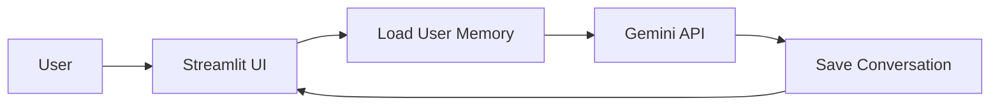
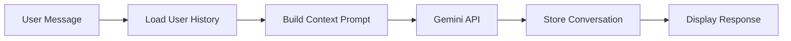

# AI Chatbot with Long-Term Memory


A conversational AI chatbot powered by Google Gemini that maintains persistent memory across sessions. The chatbot supports multiple user profiles with isolated conversation history and configurable response tones, stores all conversations locally, and uses complete conversation history as context for each response.


## Features

- **Persistent Memory** - Conversations are stored in a local JSON file and automatically loaded on startup, giving the chatbot full recall of previous interactions.
- **Multi-User Profiles** - Create up to 10 user profiles, each with isolated conversation history and preferences.
- **Configurable Response Tones** - Each user can select a preferred tone (Friendly, Technical, or Casual) that shapes how the chatbot responds.
- **Cross-Tone Detection** - When a user's query mismatches their tone preference (e.g., a technical user asking a casual question), the chatbot acknowledges the shift.
- **Pronoun Correction** - Post-processing step that fixes common LLM pronoun confusion (e.g., "I'm User" corrected to "You're User").
- **User Data Isolation** - Each user's messages and bot responses are tagged and filtered independently.
- **Session Statistics** - Sidebar displays total stored messages and current session message count per user.
- **Memory Explorer** - View raw stored conversation history for the current user.

## How It Works

1. The user sends a message through the Streamlit interface.
2. The app loads the user's complete conversation history from the JSON memory store.
3. The full history, along with the user's tone preference, is passed to the Gemini API as a single prompt.
4. The API response is post-processed for pronoun correction and cross-tone adjustments.
5. Both the user message and bot response are appended to the persistent memory file.
6. The response is displayed in the chat interface.

## Architecture



## Technology Stack

**Backend:** Python 3.8+
**Frontend:** Streamlit
**LLM:** Google Gemini 2.5 Flash (via `google-genai`)
**Storage:** Local JSON files (`conversation_history.json`, `user_profiles.json`)
**Configuration:** python-dotenv (`.env`)

## Project Structure

```
ai-chatbot-memory/
├── app/
│   └── streamlit_app.py         # Main Streamlit application and UI
├── memory/
│   └── memory_store.py          # JSON-based conversation persistence
├── retrieval/
│   └── context_retriever.py     # Conversation history retrieval
├── generation/
│   └── response_generator.py    # Gemini API integration and prompt construction
├── profiles/
│   └── user_profile.py          # User profile CRUD operations
├── conversation_history.json    # Stored conversations (auto-generated)
├── user_profiles.json           # User profiles (auto-generated)
├── requirements.txt             # Python dependencies
├── setup.bat                    # First-time setup script (Windows)
├── run.bat                      # Application launcher (Windows)
├── .env                         # API key configuration (not committed)
└── .gitignore
```

## Installation

### Prerequisites

- Python 3.8+
- A Google Gemini API key ([get one here](https://aistudio.google.com/app/apikey))

### Windows (Quick Setup)

```bash
# First-time setup (creates venv, installs dependencies, configures API key)
setup.bat

# Run the application
run.bat
```

### Manual Setup (Cross-Platform)

```bash
git clone https://github.com/yourusername/ai-chatbot-memory.git
cd ai-chatbot-memory

python -m venv genai_env
# Windows: genai_env\Scripts\activate
# macOS/Linux: source genai_env/bin/activate

pip install -r requirements.txt
```

## Configuration

Create a `.env` file in the project root:

```
GEMINI_API_KEY=your_api_key_here
```

To change the Gemini model, edit `generation/response_generator.py` and modify the `model` parameter in the `generate_content` call (default: `gemini-2.5-flash`).

## Usage

```bash
streamlit run app/streamlit_app.py
```

The app opens at `http://localhost:8501`.

1. Launch the application using the command above.
2. Create a new user profile or select an existing one from the sidebar.
3. Choose a conversation tone (Friendly, Technical, or Casual).
4. Start chatting -- the chatbot responds based on your tone preference and full conversation history.
5. Conversation history is automatically preserved across sessions.

### Sidebar Controls

- **Switch User** -- Select an existing user profile from the dropdown.
- **Create New** -- Add a new user profile with a display name and tone preference.
- **Edit Profile** -- Update display name or tone for the current user.
- **Clear Chat** -- Remove messages from the current session (long-term memory is preserved).
- **Clear Memory** -- Permanently delete all stored conversations for the current user.
- **Delete Profile** -- Remove the user profile and all associated data.
- **View Memory** -- Inspect the raw JSON memory store for the current user.

### Conversation Tones

| Tone       | Description                                            |
|------------|--------------------------------------------------------|
| Friendly   | Warm, approachable, uses emojis and simple language    |
| Technical  | Precise, detail-oriented, uses technical terminology   |
| Casual     | Relaxed, informal, uses contractions and slang         |

## Memory Workflow



Each conversation is stored locally in `conversation_history.json` and associated with a unique user identifier. When a user sends a new message, the application retrieves that user's previous conversations, combines them with the latest message and selected conversation tone, and sends the complete context to the Google Gemini API. The generated response is then displayed and stored, allowing the chatbot to maintain conversation history across multiple sessions.

## Current Limitations

- Uses local JSON files for storage instead of a database, which does not scale well for large conversation histories.
- Sends the complete conversation history with each API request, with no token-aware truncation or windowing.
- No user authentication -- profiles are identified by user ID only.
- Designed primarily for local single-machine execution.

## Future Improvements

- Replace JSON storage with a vector database for scalable memory retrieval.
- Add semantic search over conversation history instead of full-context injection.
- Implement token-aware context windowing for long conversations.
- Support additional LLM providers beyond Google Gemini.
- Add conversation export (e.g., PDF or Markdown).

---

Built as a learning project to explore conversational AI, long-term memory, prompt engineering, and modular application design.
