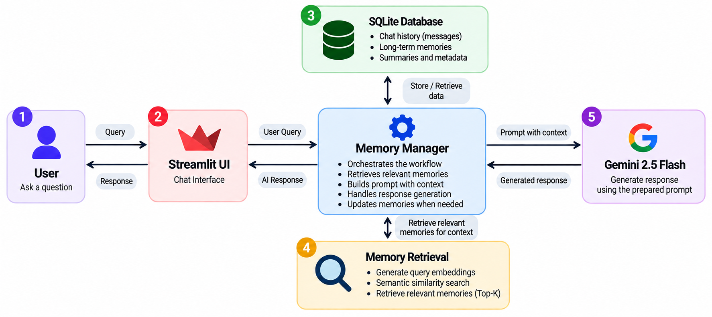

<p align="center">
  <h1 align="center">MemoryAI</h1>
</p>

<p align="center">
  <strong>An AI assistant that remembers relevant information across conversations using persistent memory and semantic retrieval.</strong>
</p>

<p align="center">
  
  
  
  
  
</p>

## Project Overview

Traditional AI chatbots often struggle to retain useful information across separate conversations. Users may need to repeat details about their preferences, ongoing projects, and previously discussed topics because earlier context is not always available in a new session.

**MemoryAI** is an academic project that addresses this limitation through a conversational AI assistant designed to retain important information and retrieve relevant memories when needed. Instead of sending the entire conversation history to the language model, it combines recent messages with semantically retrieved long-term memories, pinned information, and conversation summaries.

The application uses **Google Gemini** for response generation and memory-related tasks, **Gemini Embeddings** for semantic retrieval, and **SQLite** for persistent storage. Importance scoring and duplicate detection help select useful information for long-term retention, while automatic summarization helps manage growing conversation histories.

A **Streamlit-based chat interface** provides conversation management, memory exploration, and personalized response tones. Available memory-management features include searching, categorizing, pinning, editing, deleting, and exporting stored memories.

The project explores how persistent memory and semantic retrieval can make conversational AI more useful across sessions while maintaining a modular architecture and locally managed data.

---

## Key Features

- **Persistent SQLite Storage**: Local persistence for conversations, chat messages, vector embeddings, summaries, and user profiles.
- **Multi-Conversation Management**: Create, switch, filter, and delete independent chat sessions with automatic title generation.
- **Importance-Gated Long-Term Memory**: Evaluates user interactions with Gemini (0.0 to 1.0); only meaningful facts scoring 0.70 or higher are saved to long-term memory.
- **Cosine Deduplication**: Compares incoming memories against existing vector embeddings (threshold 0.92) to prevent saving duplicate facts.
- **Automatic Categorization**: Organizes memories into seven categories: Personal, Education, Career, Projects, Programming, Preferences, and General.
- **Hybrid Context Assembly**: Dynamically constructs prompts combining recent messages, rolling summaries, pinned memories, and semantically retrieved facts.
- **Memory Explorer**: Built-in UI to search (keyword and semantic), filter by category, pin, edit, delete, and export memories as JSON.
- **Personalized Profiles & Tone**: Supports configurable display names and response tones (Friendly, Technical, Casual) with automatic tone-shift bridging.

---

## Architecture and Workflow

### System Architecture

The diagram below illustrates the main components of MemoryAI and how the user interface, memory management, retrieval, database, and Gemini interact.

<p align="center">
  
</p>

### Request-to-Response Flow

1. **User Submission**: The user submits a prompt through the Streamlit interface.
2. **Context Assembly**: `MemoryManager` retrieves recent messages, the conversation summary, pinned memories, and relevant long-term memories.
3. **Prompt Construction**: `PromptBuilder` combines the user query with the available context and instructions.
4. **Response Generation**: Gemini generates a response, which is post-processed before being displayed.
5. **Memory Processing**: The exchange is evaluated for importance and processed for long-term storage when appropriate.
6. **Conversation Summarization**: Older messages are summarized when the configured message threshold is exceeded.

---

## Hybrid Memory Design

MemoryAI avoids sending entire chat logs to the model by partitioning memory into four complementary layers:

- **Recent Conversation**: The 20 most recent messages are always included to maintain immediate conversational continuity.
- **Relevant Long-Term Memories**: Top-10 memories semantically retrieved using cosine similarity against stored vectors.
- **Pinned Memories**: Priority user facts explicitly pinned in the Memory Explorer that persist in all prompts.
- **Rolling Summaries**: Compressed summaries of older archived conversations created when history exceeds 100 messages.

---

## Technology Stack

| Component | Technology | Purpose |
| :--- | :--- | :--- |
| **Language** | Python 3.10+ | Core application runtime |
| **Web Interface** | Streamlit | Responsive multi-view dashboard and chat UI |
| **Language Model** | Google Gemini 2.5 Flash | Conversational responses, importance scoring, summarization |
| **Embeddings** | `gemini-embedding-001` | 768-dimensional semantic vector generation |
| **Database** | SQLite 3 | Embedded database for messages, conversations, and vectors |
| **Configuration** | `python-dotenv` | Environment variable management |

---

## Project Structure

```text
MemoryAI/
│
├── app/                              # Streamlit application and UI components
│   ├── ui/                           # Chat interface, components, sidebar, and styles
│   │   ├── chat.py
│   │   ├── components.py
│   │   ├── memory_panel.py
│   │   ├── sidebar.py
│   │   └── styles.py
│   └── streamlit_app.py              # Main Streamlit application entry point
│
├── assets/                           # Project assets and visual documentation
│   └── system-architecture.png       # MemoryAI system architecture diagram
│
├── generation/                       # Prompt construction and response generation
│   ├── prompt_builder.py             # Builds prompts using retrieved context
│   ├── response_generator.py         # Generates responses using Gemini
│   └── README.md                     # Generation module documentation
│
├── memory/                           # Long-term memory management and storage
│   ├── memory_manager.py             # Coordinates memory operations
│   ├── memory_store.py               # Stores and manages long-term memories
│   ├── importance_scorer.py          # Evaluates memory importance
│   ├── memory_categorizer.py         # Categorizes stored memories
│   ├── conversation_summarizer.py    # Summarizes conversation history
│   └── README.md                     # Memory module documentation
│
├── profiles/                         # User profile and response preferences
│   ├── user_profile.py               # Manages profile and tone preferences
│   └── README.md                     # Profile module documentation (if present)
│
├── retrieval/                        # Embedding generation and context retrieval
│   ├── context_retriever.py          # Retrieves relevant conversational context
│   ├── embedding_service.py          # Generates text embeddings
│   └── README.md                     # Retrieval module documentation
│
├── database.py                       # SQLite connections, schema, and migrations
│
├── requirements.txt                  # Python project dependencies
│
├── .env.example                      # Example environment variable configuration
│
├── .gitignore                        # Excludes secrets, databases, and cache files
│
└── README.md                         # Main project overview, setup, and documentation
```

### Module Documentation

Detailed architecture, inputs, outputs, and workflows for each backend subsystem can be found in their dedicated README files:

- [`memory/`](memory/README.md) - Storage, importance scoring, categorization, and summarization.
- [`retrieval/`](retrieval/README.md) - Vector embeddings, caching, and semantic search.
- [`generation/`](generation/README.md) - Prompt building, tone adaptation, and API response handling.
- [`profiles/`](profiles/README.md) - User profile and preference persistence.

---

## Installation and Configuration

### Prerequisites

- Python 3.10 or higher
- Google Gemini API key ([Google AI Studio](https://aistudio.google.com/app/apikey))

### Setup Steps

1. **Clone the repository**:
   ```bash
   git clone https://github.com/<your-username>/ai-chatbot-memory.git
   cd ai-chatbot-memory
   ```

2. **Create and activate a virtual environment**:
   - Windows PowerShell:
     ```powershell
     python -m venv genai_env
     .\genai_env\Scripts\Activate.ps1
     ```
   - Linux / macOS:
     ```bash
     python3 -m venv genai_env
     source genai_env/bin/activate
     ```

3. **Install dependencies**:
   ```bash
   pip install -r requirements.txt
   ```

4. **Configure environment variables**:
   Create a `.env` file by copying the provided template:
   - Windows PowerShell:
     ```powershell
     Copy-Item .env.example .env
     ```
   - Linux / macOS:
     ```bash
     cp .env.example .env
     ```
   Open `.env` and set your Google Gemini API key:
   ```env
   GEMINI_API_KEY=your_gemini_api_key_here
   ```

---

## Running the Application

Start the Streamlit application:

```bash
python -m streamlit run app/streamlit_app.py
```

Once running, access the application in your browser at `http://localhost:8501`.

---

## Usage

- **Start a New Chat**: Click `+ New Chat` in the sidebar to start a new thread.
- **Switch Conversations**: Click any conversation in the sidebar list to resume it.
- **Memory Explorer**: Open the Memory view to search memories (keyword or semantic), filter by category, pin crucial facts, edit content, or export to JSON.
- **Pinned Memories**: View and manage all pinned memories in the dedicated view.
- **Settings**: Change your display name, adjust response tone (Friendly, Technical, Casual), or clear all stored database records.

---

## Example: Long-Term Memory

The following example illustrates how MemoryAI stores relevant information and retrieves it during a conversation several days later, even when the user discusses unrelated topics in between.

**Session 1: Initial Conversation**

- **User:** "I'm a computer science student working on a chatbot project using Python."
- **Assistant:** "That sounds interesting! Python is a great choice for building chatbots."

*MemoryAI evaluates the conversation and stores the relevant project information as a long-term memory.*

**Session 2: A Few Days Later**

- **User:** "Can you suggest some good places to visit in Bengaluru?"
- **Assistant:** "You could explore Cubbon Park, Lalbagh Botanical Garden, and Bangalore Palace."

*The conversation introduces an unrelated topic while the earlier project memory remains stored.*

**Session 3: Returning to the Previous Topic**

- **User:** "Which programming language am I using for my project?"
- **Assistant:** "You're using Python for your chatbot project."

*MemoryAI retrieves the relevant long-term memory through semantic similarity search and uses it to personalize the response.*

---

## Limitations and Future Improvements

### Limitations

- **Sequential Similarity Search**: Cosine similarity is computed in Python over stored SQLite embeddings. Although caching and precomputed norms reduce redundant calculations, retrieval still scales linearly with the number of stored memories.
- **Fixed Context Thresholds**: Context assembly uses fixed message-count limits (20 recent messages, top-10 long-term memories, and a 100-message summarization trigger) rather than dynamic token-aware budgeting.
- **Single-User Architecture**: The application is designed for personal use with a single hardcoded user identity. It does not provide authentication or multi-user data isolation.
- **Gemini API Dependency**: Response generation, embedding generation, importance scoring, categorization, and summarization depend on Google Gemini API availability and usage limits. Local database operations, such as keyword search and memory management, can be performed without additional API calls.
- **No Time-Based Memory Decay**: Retrieval ranking relies on cosine similarity without accounting for memory age, so outdated information may remain highly ranked when it is semantically similar to a query.

### Future Improvements

- **Dedicated Vector Indexing**: Integrate FAISS or another vector index to improve retrieval efficiency as the memory collection grows.
- **Token-Aware Context Management**: Implement dynamic token budgeting to use the model's context window more effectively and avoid exceeding token limits.
- **Time-Based Memory Relevance**: Incorporate memory age into retrieval ranking to reduce the relevance of outdated information when appropriate.
- **Alternative Model Providers**: Introduce a provider abstraction to support additional hosted or local LLM and embedding models.
- **Embedding Model Migration**: Develop a utility to regenerate stored embeddings when switching embedding models, maintaining compatibility between stored vectors and the active model.