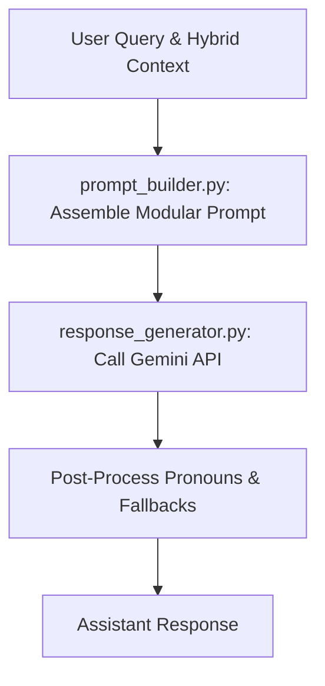

# Generation Subsystem (`generation/`)

## 1. Directory Overview
The `generation/` directory formats context-rich prompts and interfaces with the Google Gemini API to generate personalized AI responses.

## 2. Workflow

## 3. Modules

### 1. `prompt_builder.py`
Assembles modular LLM prompts by combining user queries, tone guidelines, conversation summaries, and retrieved long-term memories.
- **Input:** User query, user display name, preferred tone, and hybrid context dictionary.
- **Output:** Structured prompt string containing system instructions, persona constraints, and contextual memory blocks.

### 2. `response_generator.py`
Sends assembled prompts to Gemini 2.5 Flash, handles API error fallbacks, and corrects pronoun confusion in responses.
- **Input:** User query, prompt context, user display name, and tone preference.
- **Output:** Generated assistant response string or formatted error fallback notification.

## 4. Interactions with Other Modules
- **Memory (`memory/`):** Consumes hybrid context (recent messages, pinned memories, summaries, and semantic recall) provided by `MemoryManager`.
- **Profiles (`profiles/`):** Uses profile display name and tone preferences (`Friendly`, `Technical`, `Casual`) to adapt generation style.
- **User Interface (`app/ui/`):** Invoked directly by `chat.py` during message handling to produce live assistant replies.
