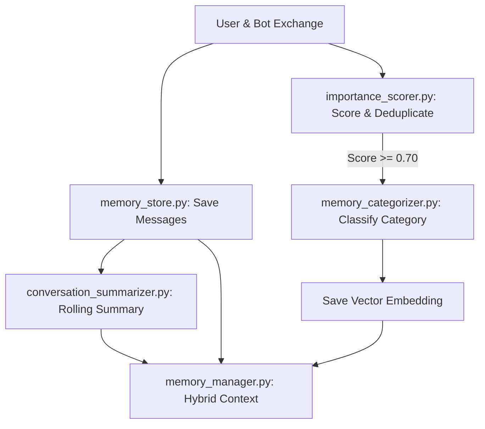

# Memory Subsystem (`memory/`)

## 1. Directory Overview
The `memory/` directory manages message persistence, importance evaluation, categorization, summarization, and context retrieval for MemoryAI.

## 2. Workflow

## 3. Modules

### 1. `memory_manager.py`
Acts as the central coordinator for conversation management, storage routing, and context assembly.
- **Input:** User queries, chat messages, search filters, and conversation IDs.
- **Output:** Hybrid prompt context dictionaries, filtered memory lists, and active conversation state.

### 2. `memory_store.py`
Performs direct SQLite database operations for conversations and message history.
- **Input:** Message roles, message text, conversation titles, and conversation IDs.
- **Output:** Stored SQLite rows, conversation listings, and chronological message logs.

### 3. `importance_scorer.py`
Evaluates whether an exchange contains enduring facts and checks for semantic duplicates.
- **Input:** User and assistant message pairs, candidate memory text.
- **Output:** Importance score (0.0–1.0) and boolean duplicate check result.

### 4. `memory_categorizer.py`
Classifies long-term memories into predefined categories such as Personal, Career, and Projects.
- **Input:** User message text.
- **Output:** Assigned category label string.

### 5. `conversation_summarizer.py`
Compresses older chat logs into a rolling summary when conversation size exceeds capacity.
- **Input:** Lists of older message dictionaries and the existing summary.
- **Output:** Updated concise summary string persisted to the database.

## 4. Interactions with Other Modules
- **Database (`database.py`):** Uses pooled SQLite connections to persist messages, conversations, and summaries.
- **Retrieval (`retrieval/`):** Generates embeddings and calculates cosine similarity for duplicate filtering and semantic memory search.
- **Generation (`generation/`):** Delivers assembled hybrid context (recent messages, pinned memories, vector recall, and summaries) to `prompt_builder.py` for LLM responses.
