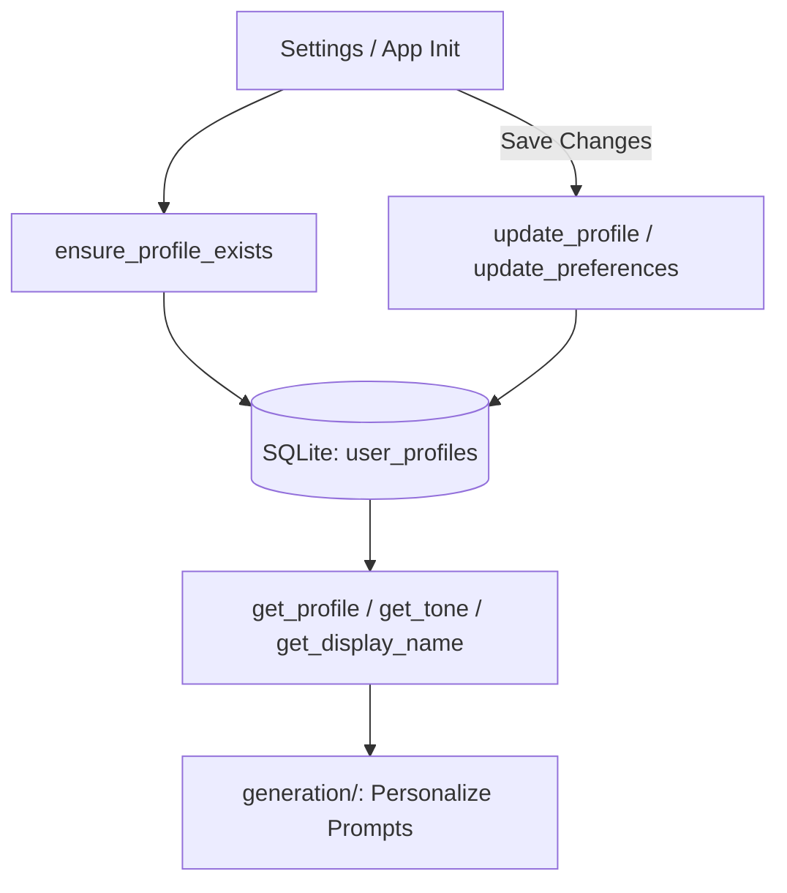

# User Profiles Subsystem (`profiles/`)

## 1. Directory Overview
The `profiles/` directory manages single-user profile configuration, tone preferences, and persistent interaction metadata in SQLite.

## 2. Workflow

## 3. Modules

### 1. `user_profile.py`
Handles SQLite-backed profile creation, display name management, response tone selection (Friendly, Technical, Casual), and custom preference storage.
- **Input:** User display name, selected tone string, and custom preferences dictionary.
- **Output:** Stored profile dictionary, current tone setting, display name string, and committed database updates.

## 4. Interactions with Other Modules
- **Database (`database.py`):** Uses thread-pooled SQLite connections to query and update the `user_profiles` table.
- **Generation (`generation/`):** Supplies user display name and response tone to `prompt_builder.py` and `response_generator.py` for personalized answers.
- **User Interface (`app/ui/`):** Loaded at startup in `streamlit_app.py`, displayed in `sidebar.py`, and edited via the Settings view in `views.py`.
