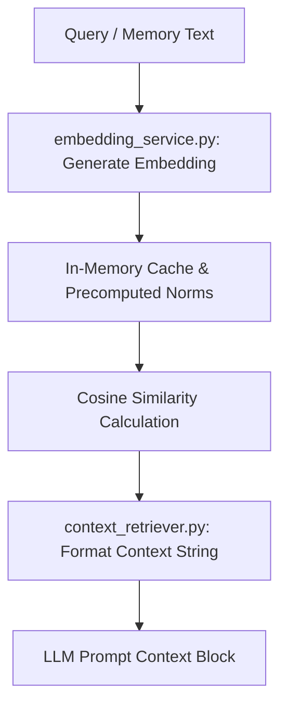

# Retrieval Subsystem (`retrieval/`)

## 1. Directory Overview
The `retrieval/` directory handles vector embedding generation, in-memory caching, cosine similarity calculations, and semantic memory search for MemoryAI.

## 2. Workflow

## 3. Modules

### 1. `context_retriever.py`
Formats retrieved memories and raw conversation logs into clean, structured text blocks suitable for LLM prompt injection.
- **Input:** Raw message lists, scored memory entries, and top-K limits.
- **Output:** Formatted context strings separated by dividers or labelled `USER:` and `ASSISTANT:`.

### 2. `embedding_service.py`
Generates 768-dimensional vector embeddings with Gemini, caches embeddings in memory, persists vectors in SQLite, and ranks memories via cosine similarity.
- **Input:** Text strings to embed, search query strings, and memory IDs.
- **Output:** Serialized binary vectors, cached float lists, and similarity-ranked memory search results.

## 4. Interactions with Other Modules
- **Database (`database.py`):** Stores and queries serialized embedding vectors, pinned flags, and category metadata in the `embeddings` table.
- **Memory (`memory/`):** Supplies duplicate detection to `importance_scorer.py` and semantic recall and persistence to `memory_manager.py`.
- **Generation (`generation/`):** Feeds Top-K semantically relevant long-term memories to `prompt_builder.py` to ground responses in past user history.
